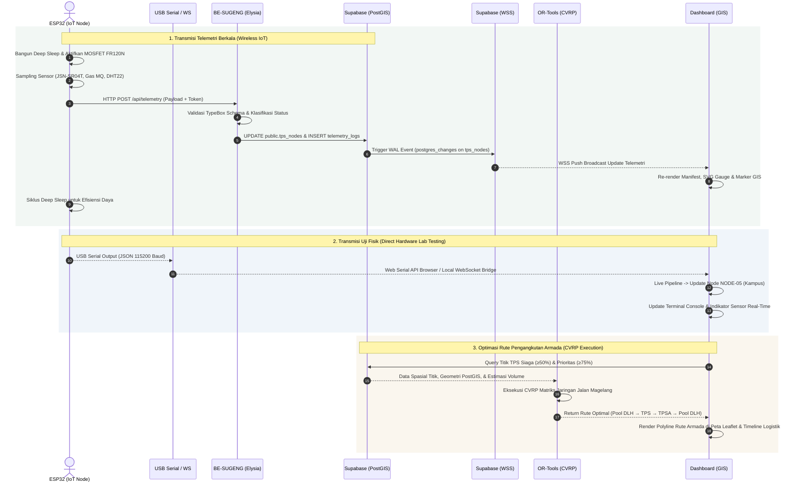

# Alur Integrasi Data Proyek SUGENG

Dokumentasi arsitektur integrasi data end-to-end dari perangkat edge sensor IoT di TPS hingga ke web dashboard SIG dan engine optimasi rute armada DLH Kota Magelang.

---

## 1. Flowchart Arsitektur Integrasi Data (5-Tier Architecture)

```mermaid
flowchart TD
    %% ==========================================================================
    %% SUGENG DATA INTEGRATION PIPELINE (VERTICAL HIGH-CLARITY ARCHITECTURE)
    %% ==========================================================================

    subgraph PerceptionTier["1. PERCEPTION & SENSING TIER (EDGE IoT NODE)"]
        direction TB
        subgraph Sensors["Transduser Sensorik (Wadah TPS HDPE 120L)"]
            direction LR
            S_US["Sensor JSN-SR04T<br/><b>Ultrasonic Waterproof IP67</b><br/>• Trig: GPIO 12 | Echo: GPIO 13<br/>• Ukur Jarak Permukaan Sampah (20 - 95 cm)"]
            S_GAS["Sensor Gas MQ-135 & MQ-4<br/><b>Deteksi Pembusukan & Metana</b><br/>• MQ-135 (NH₃ / Bau): GPIO 34 ADC1<br/>• MQ-4 (CH₄ / Metana): GPIO 35 ADC1"]
            S_ENV["Sensor DHT22 & Suplai Daya<br/><b>Mikroklimat & Baterai Mandiri</b><br/>• Data: GPIO 14 (Suhu & RH)<br/>• Solar 6V 1W + CN3065 + Li-Ion 18650"]
        end

        MCU["Mikrokontroler ESP32 DevKit V1 (Tensilica 32-bit Dual-Core)<br/>• Akuisisi ADC 12-bit & Digital Median Filtering<br/>• Formula Volume: V% = (H_total - Jarak) / (H_total - Blind) x 100%<br/>• Manajemen Deep Sleep Berkala & Pulsed Heating MOSFET FR120N"]

        Sensors -->|Sinyal ADC, One-Wire & Time of Flight| MCU
    end

    subgraph TransportTier["2. DUAL TRANSMISSION PIPELINE (PROTOKOL TRANSPORT)"]
        direction LR
        NET_HTTP["Jalur Utama: Nirkabel IoT Lapangan<br/><b>HTTP POST (JSON Telemetri)</b><br/>Header: X-Node-Token | Endpoint: /api/telemetry"]
        NET_DIRECT["Jalur Uji: Direct Hardware Lab<br/><b>USB CDC Serial (115200 Baud)</b><br/>Web Serial API Browser / Local WebSocket Bridge"]
    end

    MCU -->|Koneksi Internet WiFi / GSM| NET_HTTP
    MCU -.->|Kabel USB / Sandbox Testing| NET_DIRECT

    subgraph IngestionTier["3. INGESTION GATEWAY & MIDDLEWARE TIER (BE-SUGENG)"]
        direction TB
        GATEWAY["API Ingestion Gateway (Elysia.js + Bun Runtime Engine)<br/>• Asynchronous High Throughput I/O & OpenAPI Swagger Docs"]
        
        subgraph Processing["Pipeline Pemrosesan Data"]
            direction LR
            SEC["1. Autentikasi<br/>X-Node-Token Validation"]
            VAL["2. Sanitasi & Fallback<br/>TypeBox Strict Schema<br/>Sensor Lock (-1 Fallback)"]
            EVAL["3. Evaluasi Logika Bisnis<br/>Klasifikasi SAFE / WARNING / CRITICAL<br/>Ambang Gas Alert (NH₃ ≥ 60 / CH₄ ≥ 250)"]
        end

        GATEWAY --> SEC --> VAL --> EVAL
    end

    NET_HTTP --> GATEWAY

    subgraph PersistenceTier["4. PERSISTENCE & REALTIME TIER (SUPABASE CLOUD)"]
        direction TB
        subgraph Postgres["Basis Data PostgreSQL 15+ & PostGIS Extension"]
            direction LR
            TBL_NODES[("tps_nodes Table<br/>• Metadata Titik (ID, Nama, Alamat)<br/>• Status Keterisian Terkini (% & Liter)<br/>• Flag Sanitasi & geometry(Point, 4326)")]
            TBL_LOGS[("telemetry_logs Table<br/>• Log Time-Series Historis Lengkap<br/>• Audit Trail untuk Analisis Tren")]
            POSTGIS["PostGIS Spatial Engine<br/>• Spatial Indexing GiST<br/>• Query Geometri EPSG:4326"]
        end

        REALTIME_SRV["Supabase Realtime Service (Elixir/Phoenix WebSocket)<br/>• CDC Change Data Capture via PostgreSQL WAL<br/>• Broadcast: postgres_changes on tps_nodes"]

        TBL_NODES -->|WAL Replication Stream| REALTIME_SRV
    end

    EVAL -->|Upsert Data Keterisian Terkini| TBL_NODES
    EVAL -->|Append Riwayat Log Sensor| TBL_LOGS

    subgraph AnalyticsPresentationTier["5. ANALYTICS & PRESENTATION TIER (COMMAND CENTER COCKPIT)"]
        direction TB
        subgraph EngineCVRP["Optimasi Rute Armada (Google OR-Tools)"]
            ROUTER_ENGINE["CVRP Vehicle Routing Solver<br/>• Input: Matriks Jarak Jalan Magelang + TPS Siaga & Prioritas (≥50%)<br/>• Output: Rute Closed-Loop Pool DLH (-7.444152, 110.230185)<br/>&nbsp;&nbsp;→ TPS Siaga/Prioritas → TPSA Banyuurip → Pool DLH"]
        end

        subgraph DashboardUI["Sugeng Dashboard (Astro + React + TypeScript + Leaflet.js)"]
            direction LR
            COMP_MAP["Peta Interaktif GIS<br/>• Marker Kustom Kampus Tuguran (-7.459694, 110.216861)<br/>• Marker Pool DLH (-7.444152, 110.230185) & TPSA Banyuurip<br/>• Overlay Polyline Rute Armada CVRP"]
            COMP_MANIFEST["Manifest TPS & Wadah SVG<br/>• Indikator SVG Dinamis Realtime<br/>• Monitoring 9 Titik TPS Kota"]
            COMP_INSPECTOR["Inspector Node & Telemetri<br/>• Detail Sensor Ultrasonik & Gas<br/>• Validasi Koordinat Presisi DD"]
        end

        ROUTER_ENGINE -->|GeoJSON Path Koordinat Rute| COMP_MAP
    end

    REALTIME_SRV -->|Trigger Optimasi Armada Keterisian Siaga| ROUTER_ENGINE
    REALTIME_SRV -->|WSS Realtime Push Event| COMP_MAP
    REALTIME_SRV -->|Broadcast Status Keterisian| COMP_MANIFEST
    NET_DIRECT -.->|Direct Hardware Stream| COMP_INSPECTOR

    %% ==========================================================================
    %% COLOR SCHEME & STYLING
    %% ==========================================================================
    classDef edgeStyle fill:#f2f7f4,stroke:#2b6e49,stroke-width:1.5px,color:#183b27;
    classDef gatewayStyle fill:#f0f5fa,stroke:#2c5b88,stroke-width:1.5px,color:#152c42;
    classDef dbStyle fill:#faf6ee,stroke:#9e6e1e,stroke-width:1.5px,color:#4a320c;
    classDef aiStyle fill:#f8f2f9,stroke:#7b397d,stroke-width:1.5px,color:#3e153f;
    classDef uiStyle fill:#f4faf6,stroke:#176b49,stroke-width:2px,color:#114832;
    classDef transportStyle fill:#fbfcfb,stroke:#708276,stroke-width:1.5px,stroke-dasharray: 4 2,color:#2c3a30;

    class S_US,S_GAS,S_ENV,MCU edgeStyle;
    class GATEWAY,SEC,VAL,EVAL gatewayStyle;
    class TBL_NODES,TBL_LOGS,POSTGIS,REALTIME_SRV dbStyle;
    class ROUTER_ENGINE aiStyle;
    class COMP_MAP,COMP_MANIFEST,COMP_INSPECTOR uiStyle;
    class NET_HTTP,NET_DIRECT transportStyle;
```

---

## 2. Sequence Diagram Interaksi & Sinkronisasi Real-Time

